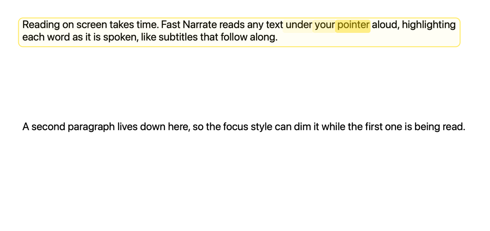
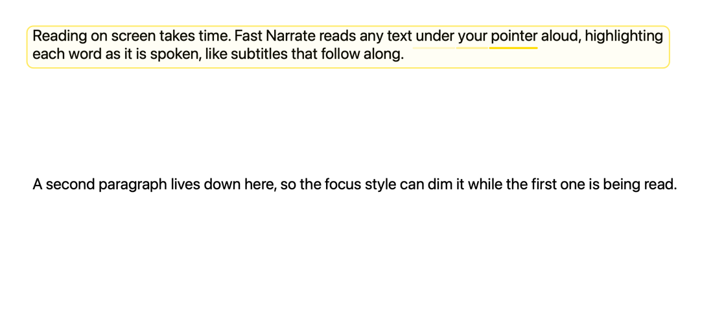
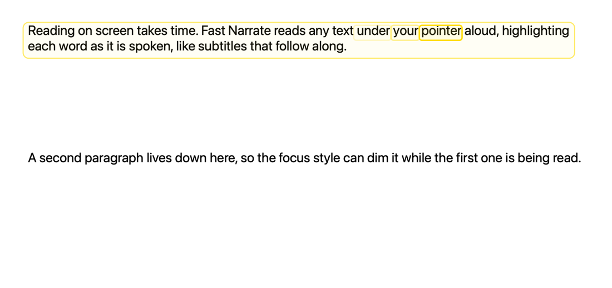
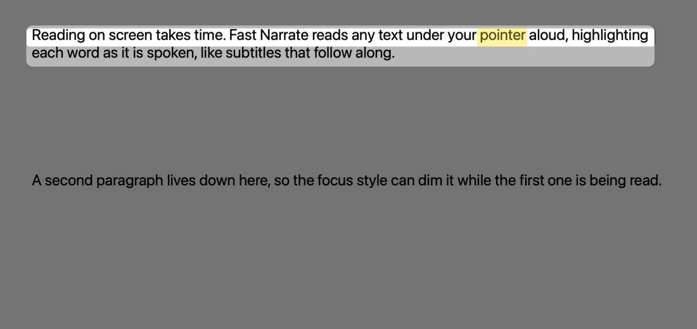

# Fast Narrate

**Point at any text on your Mac. Fast Narrate reads it aloud and lights up each word as it's
spoken, like karaoke subtitles for your whole screen.**

It's built for accessibility (dyslexia, ADHD, low vision, reading fatigue) and for reading
faster. Because it reads the pixels on screen, it works everywhere: web pages, PDFs, images,
slides, video frames, and apps that block copy and paste.

> macOS only (macOS 14 Sonoma or later, Apple silicon or Intel).

| Marker | Underline |
|---|---|
|  |  |
| **Outline** | **Focus** (dims everything but the current line) |
|  |  |

## Features

- **Reads what you point at.** Press a shortcut and reading starts at the exact word under your
  pointer. Or turn on *Follow Mouse*: rest the pointer on any paragraph and it starts there.
- **Word-by-word highlight** right on the original text, in four styles and four colors.
- **Subtitle bar** showing a few words at a time, with the current word lit up (TikTok-style).
- **Three ways to read:**
  - **Offline voice:** Apple's built-in voices. Free and private.
  - **Natural voice:** optional [ElevenLabs](https://elevenlabs.io) neural voices, with the
    highlight synced to the real audio.
  - **Silent:** no sound at all. Words light up at your chosen pace (200–750 wpm), a visual
    pacer for speed reading or for quiet places.
- **Keeps going:** moves on to the next paragraph by itself, and follows along when you scroll.
- **Multilingual:** detects each paragraph's language and picks a matching voice.
- **Private by default:** text recognition runs on your Mac (Apple Vision). Nothing is uploaded
  unless you turn on natural voices.

## Install

There's no prebuilt download yet; build it from source (about a minute).

**Requirements:** macOS 14+, Xcode 16+ or the Xcode Command Line Tools (`xcode-select --install`).

```bash
git clone https://github.com/cleanthismessup/fast-narrate.git
cd fast-narrate
scripts/build-app.sh --open
```

This builds `dist/Fast Narrate.app` and launches it. You can drag it into `/Applications`.

### First launch: allow Screen Recording

Fast Narrate needs to see the screen to read it. On first launch it shows one setup dialog:

1. Click **Open Settings**.
2. Turn on **Fast Narrate** under *Privacy & Security ▸ Screen & System Audio Recording*.
3. Click **Relaunch Fast Narrate**.

The app lives in the menu bar (look for the text-in-a-frame icon). There's no Dock icon.

## Use

| Shortcut | Action |
|---|---|
| **⌃⌥R** | Read from the word under the pointer (press again to stop) |
| **⌃⌥P** | Pause / resume |
| **⌃⌥F** | Toggle Follow Mouse |
| **⌃⌥S** | Send UI feedback (screenshot + note) |
| **Esc** | Stop (only while reading) |

Everything else is in the menu bar menu:

- **Appearance:** highlight style (Marker, Underline, Outline, Focus), color, paragraph outline,
  subtitle size and position.
- **Speed / Pace:** 0.8× to 3×. In silent mode, this shows words per minute.
- **Voice:** Silent, Natural (ElevenLabs) or Offline (Apple).

### Better offline voices

The default macOS voices sound robotic. Download a free **Premium** voice in *System Settings ▸
Accessibility ▸ Spoken Content ▸ System Voice ▸ Manage Voices…* (for example Zoe or Ava for
English). Leave Fast Narrate's voice on **Auto** and it picks the best installed voice for each
paragraph's language.

### Natural voices (optional)

Choose *Voice ▸ Set Up Natural Voices…* and paste an
[ElevenLabs API key](https://elevenlabs.io/app/settings/api-keys). The key is stored in your
macOS Keychain. When this is on, **the text being read is sent to ElevenLabs** and uses your
ElevenLabs credits. If the network or the API fails, Fast Narrate switches to the offline voice
mid-sentence.

### UI feedback

**⌃⌥S** pauses reading, takes a screenshot that *includes* the highlight and subtitles, asks
for a note, and saves a folder with `screen.png`, a zoomed `zoom.png` of the paragraph, and
`report.md` (your note, settings and exactly what was being read). The default location is
`~/Documents/Fast Narrate Feedback/`. To change it:

```bash
defaults write io.github.cleanthismessup.fastnarrate feedbackFolder ~/path/to/folder
```

## Privacy

| What | Where it goes |
|---|---|
| Screen contents | Captured in memory, read by on-device OCR, never saved (except feedback snapshots you take yourself) |
| Text being read | Stays on your Mac, unless natural voices are on, in which case it's sent to ElevenLabs |
| ElevenLabs API key | Your macOS Keychain |

No analytics, no accounts, no network access at all in offline and silent modes.

## How it works

```
shortcut / pointer rest
  → ScreenCaptureKit screenshot of the display (Fast Narrate's own windows excluded)
  → Vision OCR (on-device) → lines + a box for every word
  → layout: rebuild rows, group lines into paragraphs, find the word under the pointer
  → speech engine (Apple / ElevenLabs / silent pacer) reports which word is current
  → click-through overlay highlights it + subtitle bar shows the caption
```

- **Fast start:** Vision compiles its model per screen size the first time (~30s), so it's warmed
  up in the background at launch. After that a full Retina screen is read in about 0.3s. Follow
  mode scans while your pointer moves, so reading starts almost instantly when it stops.
- **In sync:** with natural voices, the highlight follows the audio clock using per-character
  timestamps (under 20ms drift in tests).
- **Scrolling:** the highlight hides, speech continues, and once scrolling stops the remaining
  words are re-anchored to their new positions.

| File | Role |
|---|---|
| `TextCapture.swift` | Screen capture, Vision OCR, permission handling |
| `Layout.swift` | Paragraph grouping, pointer hit-testing, scroll re-alignment |
| `Speaker.swift` | Offline Apple voices |
| `ElevenLabsSpeaker.swift` | Natural voices: streamed audio + timestamps, prefetching |
| `SilentPacer.swift` | Silent mode pacing |
| `HighlightOverlay.swift` | On-screen highlight styles |
| `SubtitleBar.swift` | Caption bar |
| `ReaderController.swift` | Ties it together: follow mode, scroll re-sync, feedback state |
| `AppDelegate.swift` | Menu bar menu, shortcuts, dialogs, feedback snapshots |

## Development

```bash
swift build                                   # debug build
.build/debug/FastNarrate --selftest           # OCR, layout, hit-test and scroll re-align test
.build/debug/FastNarrate --render-styles out  # render every highlight style to PNGs

# natural-voice streaming + timing test against a local fake ElevenLabs server
python3 scripts/fake_elevenlabs.py 8765 &
NARRATE_ELEVEN_BASE=http://127.0.0.1:8765 .build/debug/FastNarrate --selftest-stream

# live timing logs
/usr/bin/log stream --predicate 'subsystem == "io.github.cleanthismessup.fastnarrate"'
```

**Keeping the Screen Recording permission across rebuilds:** macOS ties the permission to the
app's code signature, and ad-hoc signatures change on every build. Create a self-signed
certificate once (*Keychain Access ▸ Certificate Assistant ▸ Create a Certificate…*, name
`Fast Narrate Dev`, type *Code Signing*). The build script uses it automatically. If permission
prompts keep coming back, reset the stale entry:
`tccutil reset ScreenCapture io.github.cleanthismessup.fastnarrate`.

## Roadmap

- [ ] **Explain mode:** a short spoken summary of a paragraph, highlighting the exact words each
      point comes from
- [ ] Read exact text from native apps through the Accessibility API (OCR stays as a fallback)
- [ ] Local neural voice (no cloud, no credits)
- [ ] Draggable subtitle bar and a proper Settings window
- [ ] Smarter reading order for multi-column pages and tables
- [ ] Signed and notarized release download

## License

[MIT](LICENSE)
